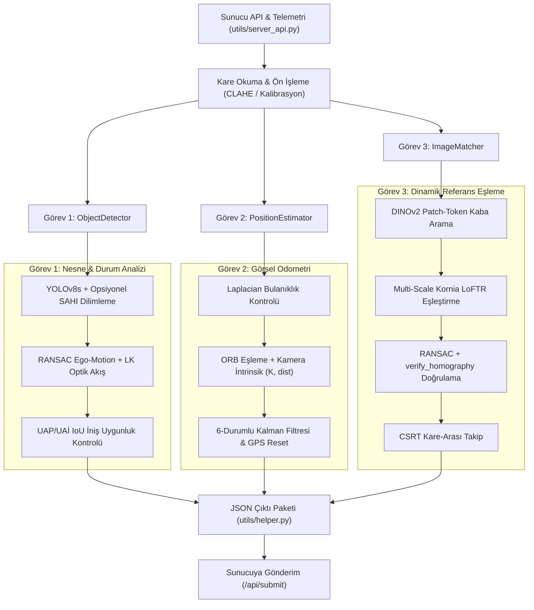

# TEMREN — Teknofest 2026 Havacılıkta Yapay Zeka Yarışması Otonom Görev Sistemi


**TEMREN**, Teknofest 2026 Havacılıkta Yapay Zeka yarışması kapsamında hava aracından alınan gerçek zamanlı görüntü ve telemetri akışlarını işleyerek **nesne tespiti**, **GPS-bağımsız görsel konum kestirimi** ve **tanımsız referans nesne eşleme/takip** görevlerini eşzamanlı yürüten modüler bilgisayarlı görü sistemidir.

---

## Sistem Mimarisi

Ana yürütücü (`main.py`), yarışma sunucusundan kare ve telemetri verilerini `7.5 FPS` hedef hızında çeker, görüntüleri ön işleme/kalibrasyon katmanlarından geçirerek üç bağımsız görev modülüne iletir ve üretilen JSON paketini sunucuya raporlar.



---

## Görev Modülleri ve Algoritmik Yaklaşım

### Görev 1: Nesne Tespiti, Hareket Analizi ve İniş Alanı Uygunluğu (`tasks/task1_detection.py`)
- **Tespit Omurgası:** `Taşıt (0)`, `İnsan (1)`, `UAP (2)` ve `UAİ (3)` sınıfları için YOLOv8 tabanlı çıkarım yapılır. Yüksek irtifada küçülen hedefler için **SAHI** (`USE_SAHI_SLICING`) destekli örtüşen yama taraması ve sınıf bazlı NMS birleştirme desteği bulunur.
- **Hareket Durumu Kestirimi (`motion_status`):** Ardışık kareler arasında arka plan kamera hareketi (`ego-motion`) global köşe noktaları ve RANSAC homografisi ile ayrıştırılır. Her taşıt kutusu içindeki noktalar geri yönde `Lucas-Kanade` optik akışı ile takip edilerek artık yer değiştirmeye göre hareketli (`"1"`) veya hareketsiz (`"0"`) kararı verilir.
- **İniş Alanı Uygunluğu (`landing_status`):** Tespit edilen UAP ve UAİ bölgeleri, sahnedeki taşıt ve insan kutularıyla IoU ve kapsama oranı (`containment`) üzerinden karşılaştırılır; engel çakışması eşiği aşarsa uygun değil (`"0"`), temizse uygun (`"1"`) olarak işaretlenir.

### Görev 2: GPS-Bağımsız Görsel Konum Kestirimi (`tasks/task2_position.py`)
- **Sensör ve Kalibrasyon Entegrasyonu:** `data/Kamera_Kalibrasyon_Parametreleri_2026.txt` içerisindeki **Termal**, **RGB 4K** ve **RGB 1080p** kamera intrinsik matrisleri (`K`) ve radyal/teğetsel distorsiyon katsayıları `utils/calibration_parser.py` ile otomatik yüklenir.
- **Görsel Odometri (Visual Odometry):** Ardışık karelerde `ORB` öznitelikleri çıkarılır, `Hamming BFMatcher` ve Lowe oran testi (`LOWE_RATIO_THRESHOLD`) ile filtrelenip lens distorsiyonundan arındırılır. `RANSAC` tabanlı kısmi afin dönüşüm ile optik merkezdeki piksel kayması ve ölçek değişimi hesaplanarak uçuş yüksekliği (`H`) ve odak uzaklığı (`f`) üzerinden metre cinsinden `(dx, dy, dz)` yer değiştirmeye dönüştürülür.
- **Bulanıklık Yönetimi ve Kalman Filtresi:** Ani dönüşlerde oluşan hareket bulanıklığı `Laplacian` varyansı ile algılanır; bulanık karelerde hatalı ölçüm yerine 6 durumlu `(x, y, z, vx, vy, vz)` Kalman Filtresi tahmini kullanılır. Sunucudan `health_status == 1` geldiğinde birikimli sürüklenme (`drift`) sıfırlanır.

### Görev 3: Dinamik Referans Nesne Eşleme ve Takip (`tasks/task3_matching.py`)
Yarışma anında verilen tanımsız referans nesnelerin farklı açı, ölçek ve aydınlatma koşullarında tespiti için iki aşamalı hibrit bir eşleme ve takip mimarisi kullanılır:
1. **Aşama 1 — DINOv2 Kaba Arama:** Kare ve referans görüntüler `CLAHE` ön işlemesinden geçirilir. `dinov2_vits14` modelinin `patch token` temsilleri çıkarılarak kare üzerinde kosinüs benzerliği ısı haritası hesaplanır; kare başına öznitelik çıkarımı tek sefer yapılarak çoklu referanslarda yüksek hız korunur.
2. **Aşama 2 — Multi-Scale LoFTR & Geometrik Doğrulama:** Aday merkezler etrafında `CANDIDATE_SCALES` ölçeklerinde kırpmalar alınır ve dedektör-bağımsız `Kornia LoFTR (outdoor)` ile yoğun piksel eşleştirmesi yapılır. `RANSAC` homografi kestirimi ve `verify_homography` (alan oranı, konvekslik, determinant kontrolleri) ile yanlış pozitifler elenir.
3. **Aşama 3 — CSRT Kare-Arası Takip:** Doğrulanan nesneler ara karelerde OpenCV `CSRT` takipçisi ile izlenir ve `TRACKER_REDETECTION_INTERVAL` periyodunda DINOv2+LoFTR ile yeniden doğrulanır.

---

## Proje Dizin Yapısı

```text
Temren/
├── main.py                                      # Ana yarışma döngüsü ve sunucu entegrasyonu
├── config.py                                    # Tüm görev ve model hiperparametreleri
├── requirements.txt                             # Python bağımlılık listesi
├── TEAM_INTERFACE.md                            # Modül geliştirme arayüz sözleşmesi
├── benchmark_task3.py                           # Görev 3 sentetik IoU / FPS benchmark betiği
├── test_2026_dataset.py                         # Çoklu referanslı video veri seti test betiği
├── video_test_task3.py                          # Tekli referans video test betiği
├── colab_visdrone_test.ipynb                    # Google Colab GPU test ve parametre ayar defteri
├── data/
│   └── Kamera_Kalibrasyon_Parametreleri_2026.txt # Termal, RGB 4K ve 1080p kamera kalibrasyonları
├── tasks/
│   ├── __init__.py
│   ├── task1_detection.py                       # Görev 1: YOLOv8 + SAHI + Optik Akış + İniş Kontrolü
│   ├── task2_position.py                        # Görev 2: ORB Görsel Odometri + Kalman Filtresi
│   └── task3_matching.py                        # Görev 3: DINOv2 + LoFTR + CSRT Hibrit Pipeline
└── utils/
    ├── __init__.py
    ├── calibration_parser.py                    # Kamera kalibrasyon dosyası ayrıştırıcı
    ├── helper.py                                # Yarışma JSON çıktı formatlayıcıları
    ├── logger.py                                # Dosya ve konsol loglama altyapısı
    ├── preprocessing.py                         # CLAHE kontrast iyileştirme ve homografi doğrulama
    └── server_api.py                            # Sunucu telemetri alma ve sonuç gönderme istemcisi
```

---

## Kurulum ve Çalıştırma

### 1. Ortam Kurulumu
```bash
git clone https://github.com/necmettinsnmz/Temren.git
cd Temren

python -m venv venv
# Windows PowerShell:
.\venv\Scripts\Activate.ps1
# Linux / macOS:
# source venv/bin/activate

pip install -r requirements.txt
```

> **Not:** Görev 1'de eğitilmiş özel YOLOv8 ağırlıkları (`models/yolov8s_temren.pt`) kullanılacaksa `pip install ultralytics` paketinin kurulu olması gerekir. Ağırlık dosyası mevcut olmadığında `ObjectDetector` güvenli fallback modunda çalışır.

### 2. Ana Sistemi Çalıştırma
`config.py` içerisindeki `SERVER_URL` ve `USER_URL` alanlarını kendi takım bilgilerinize göre güncelledikten sonra ana döngüyü başlatabilirsiniz:
```bash
python main.py
```

### 3. Görev 3 Test ve Benchmark Betikleri
- **Sentetik Dönüşüm Benchmark'ı (IoU & FPS):**
  ```bash
  python benchmark_task3.py
  ```
- **Çoklu Referans Nesneli Video Testi:**
  ```bash
  python test_2026_dataset.py --video path/to/video.mp4 --ref_dir path/to/refs --out test_outputs/sonuc.mp4
  ```
- **Tekil Referans Video Testi:**
  ```bash
  python video_test_task3.py --video path/to/video.mp4 --ref path/to/ref.jpg --out test_outputs/tek_nesne.mp4
  ```
- **Kalibrasyon Ayrıştırıcı Doğrulaması:**
  ```bash
  python -m utils.calibration_parser
  ```

---

## Sunucu İletişim ve Çıktı Formatı

Her kare sonunda sunucuya gönderilen birleşik JSON yükü `TEAM_INTERFACE.md` standardına birebir uyumludur:

```json
{
  "id": "test_video_1_f1",
  "user": "http://localhost/users/1/",
  "frame": "http://127.0.0.25:5000/frames/3598/",
  "detected_objects": [
    {
      "cls": "0",
      "landing_status": "-1",
      "motion_status": "1",
      "top_left_x": 100.5,
      "top_left_y": 200.0,
      "bottom_right_x": 300.2,
      "bottom_right_y": 400.1
    }
  ],
  "detected_translations": [
    {
      "translation_x": 0.5,
      "translation_y": -0.2,
      "translation_z": 0.0
    }
  ],
  "detected_undefined_objects": [
    {
      "object_id": 1,
      "top_left_x": 262.87,
      "top_left_y": 734.47,
      "bottom_right_x": 405.2,
      "bottom_right_y": 847.3
    }
  ]
}
```
